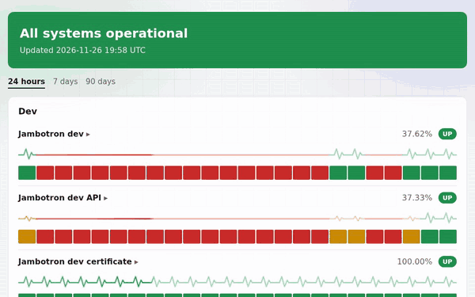

# Jammonic — uptime monitoring you configure with code

Free, self-hosted uptime monitor: HTTP, TCP, certificate and push checks, a public status page and alerts.
Everything is set up through a REST API or one YAML file. One Docker image.



- **Website:** https://jammonic.com
- **Docs:** https://jammonic.com/docs/
- **Docker image:** https://hub.docker.com/r/jambotron/jammonic

## Try it

```bash
docker run -d --name jammonic -p 8080:8080 -v jammonic-data:/data \
  -e MONITOR_API_KEYS=change-me \
  jambotron/jammonic:latest
```

Open `http://localhost:8080`, sign in with the key `change-me` and add a check — or from the terminal:

```bash
curl -X PUT -H "X-Api-Key: change-me" -H 'Content-Type: application/json' \
  -d '{"name":"example.com","type":"HTTP","target":"https://example.com","intervalSeconds":60,"statusPage":true}' \
  http://localhost:8080/api/v1/checks/by-external-id/example-web
```

The public status page is at `http://localhost:8080/status`.

## License

Free for any use, including commercial. Not open source: the source code is not published —
see [the license](https://jammonic.com/docs/license.html).

This repository is a copy of the jammonic.com site, also served by GitHub Pages.
Made by [Jambotron](https://jambotron.com).
